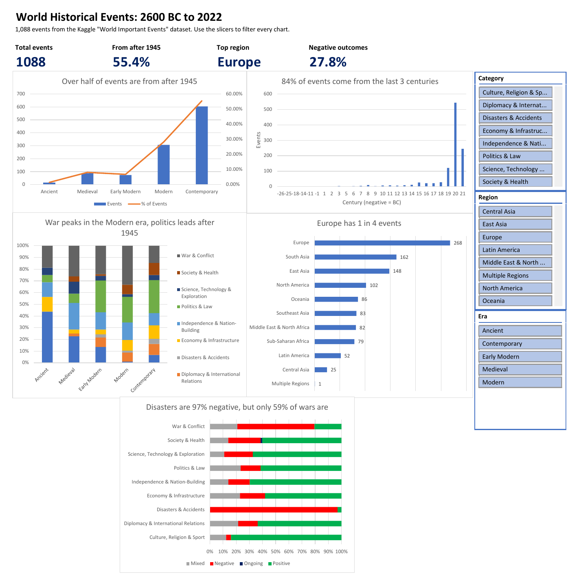

# Historical Events & Timeline Analysis (Excel)

An Excel project that cleans, explores and visualises **1,088 major world events from 2600 BC to 2022**, to answer one question:

**How have major world events been spread across time, regions and categories?**

**Tools:** Microsoft Excel 2021: Power Query, formulas (`XLOOKUP`, `LET`, `IFS`, `GETPIVOTDATA`), PivotTables, PivotCharts, slicers



## Key insights

1. **The record leans heavily toward recent history.** 55% of events are from after 1945, and 84% from the last three centuries. The busiest decade is the 2010s.
2. **Europe dominates, especially early on.** Europe has 1 in 4 events overall and about half of all events before 1800.
3. **What gets recorded changes by era.** Ancient events are mostly culture and religion (44%), war peaks in 1800–1945 (33%), and politics leads after 1945 (28%).
4. **Africa's story is independence.** 95% of Sub-Saharan African events are from after 1945, and over half are about independence and nation-building.
5. **Outcome labels are subjective.** Disasters are 97% "Negative", but only 59% of wars are, since wars that led to independence are often marked "Positive".

Full write-up with numbers, limitations and next steps: [insights](docs/insights.md).

## What's in the workbook

[`workbook/historical_events_analysis.xlsx`](workbook/historical_events_analysis.xlsx)

| Sheet | What it does |
|---|---|
| **Dashboard** | KPI cards, 5 charts and 3 slicers (Era, Region, Category) that filter everything at once |
| **Lookups** | Country → region and event type → category tables |
| **Analysis** | 5 PivotTables behind the charts |
| **Clean_Data** | Cleaned table (Power Query) plus formula columns: Century, Era, Country_Std, Region, Category |
| **Raw_Data** | Original data, loaded untouched with Power Query |
| **Profiling** | Data-quality checks done with formulas before cleaning |

**To use it:** open the workbook and click the slicer buttons on the Dashboard (Ctrl+click to pick several). To reload the data on another computer, point Power Query to `data/raw/World Important Dates.csv` (**Data → Get Data → Data Source Settings → Change Source**), then use **Data → Refresh All**.

## How I built it

### The data

- **1,096 events** (one row per event) with **12 columns**: name, day, month, year, country, type of event, place, impact, affected population, person or group responsible, and outcome (Positive, Negative, Mixed or Ongoing).
- Covers **2600 BC to 2022 AD** across **113 countries**.
- Imported into Excel with **Power Query** (`Raw_Data` query), so the raw file is never edited and the workbook can be refreshed.
- Every column is described in the [data dictionary](docs/data_dictionary.md).

### Data quality

Before cleaning, I profiled every column with formulas on the `Profiling` sheet. Main findings:

- **Missing values were hidden.** No cell was truly blank. Gaps were written as the word "Unknown", or as Date cells holding only spaces. Date was **41%** missing, Month **36%**.
- **8 events were entered twice** (16 rows).
- **Year was stored as text**, because of 7 BC dates like "2600 BC", and **2 events had year 0**, which doesn't exist.
- **Hyphens had been replaced by "Unknown"** inside text in 234 rows (e.g. "IndoUnknownPakistani War").

Full details: [data profiling notes](docs/data_profiling.md).

### Data cleaning

All cleaning is done in Power Query (`Clean_Data` query), so every step is recorded and repeatable.

- Trimmed extra spaces and turned "Unknown" and space-only cells into real blanks (`null`).
- Put the hyphens back in the 234 affected rows ("Indo-Pakistani War").
- Removed the 8 duplicate events, keeping the more complete copy: **1,096 → 1,088 rows**.
- Added a numeric `Year_Num` column with BC years as negatives (2600 BC → -2600), so events sort and chart in the right order.
- Corrected the two year-0 events with sourced approximate years (68 AD and 100 BC).
- Checked the result by re-running the same rules outside Excel: 0 differences.

Cleaned data: [`data/cleaned/world_important_events_clean.csv`](data/cleaned/world_important_events_clean.csv). Every change, with reasons and sources: [cleaning log](docs/cleaning_log.md).

### Helper columns

To group and filter events, I added five formula columns to the cleaned table:

- **Century** (`ROUNDUP`) and **Era** (`LET` + `IFS`): five eras, from Ancient (to 499 AD) to Contemporary (1946 onward).
- **Country_Std** and **Region** (`XLOOKUP`): a lookup table maps the 113 country values (including cities and old names like Babylon or Persia) to 94 countries and 10 world regions.
- **Category** (`XLOOKUP`): a second lookup table groups the 402 event types into 9 categories, such as War & Conflict, Politics & Law and Science, Technology & Exploration.

Lookup tables: [`data/reference/`](data/reference/). Column details: [data dictionary](docs/data_dictionary.md).

### Exploration

Five PivotTables on the `Analysis` sheet answer the first questions about the data:

- **More than half of the events (55%) are from 1946 onward**, and 84% are from the last three centuries. Early history is covered by a few landmark events.
- **Europe has about 1 in 4 events**, while Latin America and Central Asia are thinly covered.
- **What history "looks like" changes by era:** Ancient events are mostly culture and religion (44%), war peaks in the Modern era (33%), and politics leads in the Contemporary era (28%).
- **Outcome labels are subjective:** only 59% of wars are marked Negative.

Details: [exploration notes](docs/exploration.md).

### Charts

Five PivotCharts on the `Dashboard` sheet turn the exploration into visuals. Each title states the finding:

1. Over half of events are from after 1945 (combo chart: count + % share)
2. 84% of events come from the last 3 centuries (column chart by century)
3. Europe has 1 in 4 events (ranked bar chart by region)
4. War peaks in the Modern era, politics leads after 1945 (100% stacked columns)
5. Disasters are 97% negative, but only 59% of wars are (100% stacked bars)

Chart types and design choices: [charts notes](docs/charts.md).

### Dashboard

The `Dashboard` sheet (first sheet in the workbook) brings it all together on one page:

- **Four KPI cards:** total events, share from after 1945, top region, share of negative outcomes. Each is linked to a PivotTable with `GETPIVOTDATA`, so it updates with the filters.
- **The five charts** described above.
- **Three slicers (Era, Region, Category)** connected to every PivotTable, so one click filters the whole page.

Details: [dashboard notes](docs/dashboard.md).

## Project structure

```
data/raw/         original dataset, never edited
data/reference/   lookup tables (country to region, event type to category)
data/cleaned/     cleaned data exported from Excel
workbook/         the Excel workbook
docs/             data dictionary, profiling, cleaning log, exploration, charts, dashboard, insights
images/           dashboard screenshot
```

## Dataset

[World Important Events - Ancient to Modern](https://www.kaggle.com/datasets/saketk511/world-important-events-ancient-to-modern) by saketk511 on Kaggle. Used for learning purposes.
